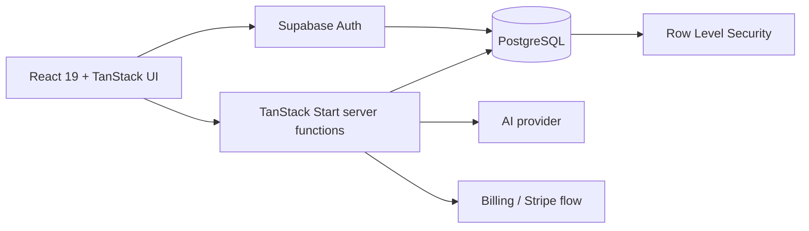

# LavaFlow

> Multi-tenant SaaS for car-wash operations and revenue growth.

LavaFlow combines day-to-day operations, customer history, scheduling, loyalty/commercial workflows, reporting and an intelligent assistance layer in one responsive product.

**Live demo:** https://lavaflowservice.lovable.app


## The problem

Small service businesses often operate across disconnected tools: WhatsApp conversations, spreadsheets, paper queues, manual follow-ups and separate financial controls. That makes it harder to understand daily capacity, customer history and missed revenue opportunities.

## The solution

LavaFlow centralizes the operational flow of a car wash and adds business context on top of it: service orders, customers, vehicles, scheduling, queue management, loyalty, reporting and commercial/intelligence features.

## Core product areas

- **Dashboard** — operational and revenue indicators.
- **Queue / Kanban** — visual service flow with drag-and-drop interactions.
- **Customers & vehicles** — customer profiles, vehicles and service history.
- **Service orders** — creation and status tracking of active work.
- **Scheduling** — authenticated scheduling plus a public booking flow by business slug.
- **Team & commissions** — team-related workflows and commission handling present in the application.
- **Loyalty & plans** — loyalty, subscription and entitlement-related product flows.
- **Reports** — business metrics and charts.
- **Growth / opportunities** — commercial opportunity and agenda-fill workflows.
- **AI assistance** — an OpenAI-compatible intelligence layer using business context.
- **PWA** — installable web-app experience.

## Tech stack

- React 19
- TypeScript
- TanStack Start
- TanStack Router
- TanStack Query
- Tailwind CSS v4
- Radix UI / shadcn-style components
- Supabase + PostgreSQL
- dnd-kit
- Recharts
- AI SDK / OpenAI-compatible provider
- Vite PWA

## Multi-tenant security

Tenant isolation is enforced primarily at the database layer with PostgreSQL Row Level Security.

Security hardening documented in the project includes:

- tenant-scoped `INSERT` validation with `WITH CHECK`;
- symmetric `WITH CHECK` rules on updates to prevent changing ownership across tenants;
- explicit grants for authenticated and service-role access;
- anonymous access removed from internal tables;
- restricted execution of internal RPC/functions;
- public booking functions exposing only safe projections needed by the public scheduling flow.

The project documentation intentionally separates completed hardening from future security work rather than presenting planned work as already shipped.

## Architecture



## Engineering decisions

### Database-level tenant isolation
Authorization is not treated only as a UI concern. Tenant ownership rules are enforced in PostgreSQL through RLS and `WITH CHECK` policies.

### Public booking without opening the database
The scheduling page can be accessed publicly, but only through intentionally exposed functions that return safe projections instead of unrestricted table access.

### Server-side integration boundaries
AI, billing and business logic live behind server-side functions rather than exposing secrets or privileged operations in client code.

### Product entitlements
The project contains entitlement and plan logic so features can be gated according to subscription/product level.

### Operational UX
Drag-and-drop queue management, dashboards and mobile-first navigation are designed around the workflow of a real service operation rather than a CRUD-only admin panel.

## Project structure

```text
src/
├── components/
│   ├── dashboard/
│   ├── booking/
│   ├── clientes/
│   ├── equipe/
│   └── opportunities/
├── hooks/
├── integrations/
│   └── supabase/
├── lib/
│   ├── assistente.*
│   ├── billing.*
│   ├── growth.*
│   ├── rbac.ts
│   └── whatsapp.ts
├── routes/
│   ├── _authenticated/
│   ├── api/
│   └── agendar.$slug.tsx
└── pwa/
```

## Run locally

Requirements:

- Node.js or Bun
- Supabase project/environment
- required environment variables for enabled integrations

```bash
npm install
npm run dev
```

or:

```bash
bun install
bun run dev
```

Do not commit production secrets. Use local environment variables and the provided environment example where applicable.

## What this project demonstrates

For a recruiter or engineering team, LavaFlow is evidence of work beyond isolated UI screens:

- full-stack TypeScript application design;
- React component architecture;
- routing and server functions;
- PostgreSQL data modeling;
- multi-tenant authorization;
- business rules and product entitlements;
- charts and operational interfaces;
- third-party integrations;
- AI-assisted product features;
- product thinking around a real operational workflow.

## Status and next improvements

Current priorities include further automated testing, deeper RBAC/governance hardening, stronger observability and continued validation of commercial/billing flows.

---

Built as a product-focused software engineering project.